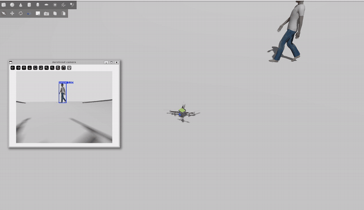

# AeroScout X450: a CAD-designed quadcopter that tracks people with AI, in simulation

A 450 mm quadcopter designed from scratch in SolidWorks, then flown in simulation
(PX4 + ROS 2 + Gazebo) by a YOLOv8 person-tracking pipeline. The simulated drone is
built from the real CAD: same mass, centre of gravity, inertia, motor positions and
camera position. Real, purchasable parts (see the bill of materials) are used for the design.



Full video: [media/demo.mp4](media/demo.mp4)

## What it does

```
Gazebo camera --> ROS 2 image --> YOLOv8n person detector --> tracker --> PX4 offboard setpoints --> drone
```

1. The drone takes off to 1.5 m with PX4 offboard control from ROS 2.
2. A camera on the front of the frame sends images to a YOLOv8n detector (GPU).
3. The tracker turns the drone to keep the person centred and moves forward or back to hold distance.
4. If the person is lost for a few seconds, the drone turns slowly to search for them.

In the logged run, altitude stayed within 1.4-1.5 m and the person stayed within 40-60 % of the image width.
The person's size in the frame swings as the person turns around, because the simple proportional controller lags behind them.

## The drone

| Item | Choice |
|---|---|
| Frame | Custom 450 mm (motor-to-motor) X frame: plates, arms, standoffs, landing legs, camera mount |
| Motors / props | 2212 920 KV, 10x4.5 propellers (2 CW, 2 CCW) |
| ESC | SpeedyBee 55 A |
| Flight controller | Pixhawk 6C Mini (PX4) |
| Companion computer | NVIDIA Jetson Orin Nano developer kit |
| Camera | IMX219 |
| Battery | Tattu 4S 5200 mAh |
| Mass (CAD) | 1.361 kg, plus about 0.17 kg of extra items from the "Buy Also" sheet (about 1.5 kg estimated at take-off) |

The full list with links, masses and open questions is in [bom/AeroScout_X450_BOM.xlsx](bom/AeroScout_X450_BOM.xlsx).
Items marked VERIFY there (Jetson and Pixhawk hole patterns, motor mass, propeller mass, camera size,
post length, legs) must be checked against the real parts before anything is bought or printed.

## Repository layout

| Folder | What is in it |
|---|---|
| `parts/` and the assembly | SolidWorks parts and the drone assembly (the CAD source) |
| `cad_export/stl/` | The 34 STL files exported from the assembly, one per part (millimetres) |
| `sim/build_aeroscout_model.py` | Builds the Gazebo model and PX4 airframe from the STL files and CAD numbers |
| `ros/` | ROS 2 nodes: take-off test, YOLO detector, person tracker, walking-person mover, viewers |
| `scripts/` | One small script per terminal, so you can run the demo without retyping commands |
| `bom/` | Bill of materials spreadsheet |
| `x500_ref/` | Copies of PX4's x500 files used as the starting point for the model (BSD-3, from PX4) |
| `docs/` | Setup, running, CAD notes, troubleshooting, and the exact software versions used |
| `media/` | Demo video and GIF |

## Quick start

Full details are in [docs/SETUP.md](docs/SETUP.md) (one-time install) and [docs/RUN_DEMO.md](docs/RUN_DEMO.md).

```bash
# after the one-time setup, from the repo folder in WSL:
mkdir -p ~/aeroscout_meshes && cp cad_export/stl/*.stl ~/aeroscout_meshes/
python3 sim/build_aeroscout_model.py          # builds the model into your PX4 folder

# then, one terminal each:
bash scripts/1_agent.sh        # ROS 2 <-> PX4 link
bash scripts/2_sim.sh          # PX4 + Gazebo with the AeroScout
bash scripts/3_world.sh        # spawns the person and starts the camera bridge
bash scripts/4_detector.sh     # YOLO
bash scripts/5_tracker.sh      # take off and track
bash scripts/6_walker.sh       # makes the person walk
```

## How the CAD becomes a simulator model

* SolidWorks uses Y up. Gazebo uses Z up. Meshes are rotated 90 degrees about X and scaled by 0.001 (mm to m).
* Mass 1.361 kg, centre of mass and inertia come from SolidWorks Mass Properties. The script subtracts the four
  propellers (which are separate spinning links) so the total mass stays equal to the CAD value.
* The four motors are at +-0.1591 m, matching the CAD, and PX4's control allocation uses the same numbers
  (`CA_ROTORn_PX/PY` in the generated airframe `4090_gz_aeroscout_x450`).
* Hover thrust is set to 0.4 (the stock x500 at 2 kg uses 0.6).
* Sensors and the motor plugins are copied from PX4's own x500 files at build time, so they match your PX4 version.

More detail is in [docs/CAD_NOTES.md](docs/CAD_NOTES.md).

## Known limits

* Simulation only. Nothing has been flown on real hardware.
* The simulated motors use the stock x500 motor constants, not measured data for the 2212 920 KV motor with a 10x4.5 propeller.
  Real thrust, battery sag and flight time are not modelled.
* The tracker is a simple proportional controller using the person's size for distance. It is not a full tracker
  (no velocity estimate, no re-identification between several people, picks the largest person).
* The "person" is a Gazebo model moved along a fixed path.

## Next steps

* Resolve the VERIFY items in the BOM, then order parts.
* Add thrust and battery data for the real motor, propeller and 4S pack.
* Bring up the Jetson and Pixhawk on a bench (serial link, MAVLink or XRCE-DDS) before any flight.
* Improve distance control (damping or a feed-forward term).

## Credits

PX4 Autopilot, ROS 2, Gazebo, Micro XRCE-DDS and Ultralytics YOLOv8 are the work of their respective projects.
Files in `x500_ref/` are from PX4 (BSD-3-Clause). The rest of this repository is under the MIT licence.
