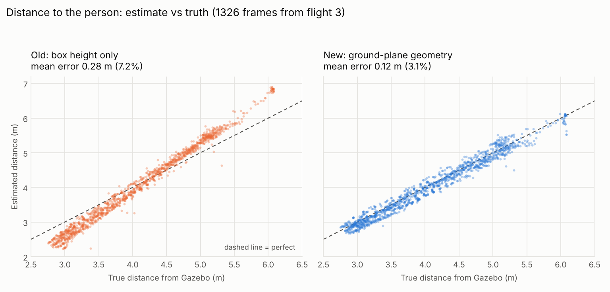
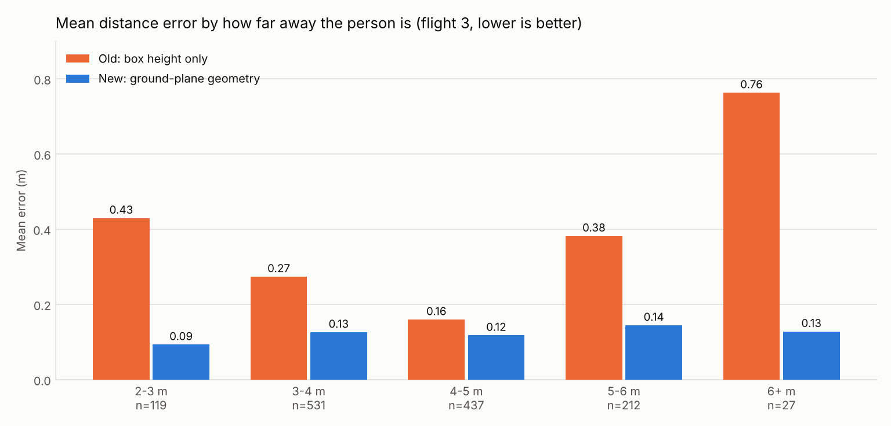

# Distance estimation results

How well can the AeroScout tell how far away the person is, using only the camera box and the drone's own
height and tilt? Everything here is **simulation**. Truth comes from Gazebo.

## Method

The bottom of the YOLO box is where the person's feet touch the ground. The camera's height and tilt are
known from PX4, so the pixel row of the feet gives an angle below the horizon, and the ground-plane
geometry turns that angle into a distance (`analysis/distance_estimator.py`).

The **old method** used the box height only: `distance = k / box_height`, with `k` fitted once on flight 1.

A small calibration (vertical focal scale 1.18, pixel offset 0.022 of image height, spawn height 0.053 m)
was fitted on flights 1 and 2 and then frozen into `ros/distance_estimator_node.py`.

## Result (flight 3, nothing fitted on it, 1,326 frames, person 2.7 to 6.1 m away)

| Method | Mean error | % of distance | Worst 5% of frames | Largest |
|---|---|---|---|---|
| Old box-height proxy | 0.277 m | 7.2% | 0.587 m | 1.13 m |
| Ground-plane geometry, uncorrected | 0.231 m | 6.0% | 0.441 m | 0.98 m |
| **Ground-plane geometry, calibrated** | **0.123 m** | **3.1%** | **0.274 m** | 0.82 m |

Sideways offset error: 0.04 m mean. Forward error: 0.12 m mean.

| True distance | Old proxy (mean error) | Calibrated geometry (mean error) |
|---|---|---|
| 2-3 m | 0.43 m | 0.09 m |
| 3-4 m | 0.27 m | 0.13 m |
| 4-5 m | 0.16 m | 0.12 m |
| 5-6 m | 0.38 m | 0.14 m |
| 6+ m (27 frames only) | 0.76 m | 0.13 m |




## What is established, and what is not

- The geometry roughly halves the error compared with the box-height proxy, and the worst frames improve
  by about half. The old method is competitive only around 4-5 m, where its constant was fitted.
- PX4's tilt agrees with Gazebo's to 0.1 degrees. Its camera height was within about 3 cm.
- **The geometry reads about 0.23 m short before calibration, on every flight.** The cause is not known.
  The calibration (focal scale and pixel offset) is a fit. The two numbers trade off against each other, so
  they should not be read as physical camera properties.
- PX4's altitude offset changed by about 3 cm between flights, so the spawn-height constant is not exact.

## Limits

- Three flights, one simulated person, one walking path, flat ground, one camera model.
- The calibration may not transfer to another camera, person or terrain.
- The estimate needs the person's feet in the image. It does not work when the feet are hidden or when the
  drone is very close and the feet leave the frame.

## Reproduce

```
python3 analysis/make_plots.py analysis/flight3.csv analysis/plots
```
